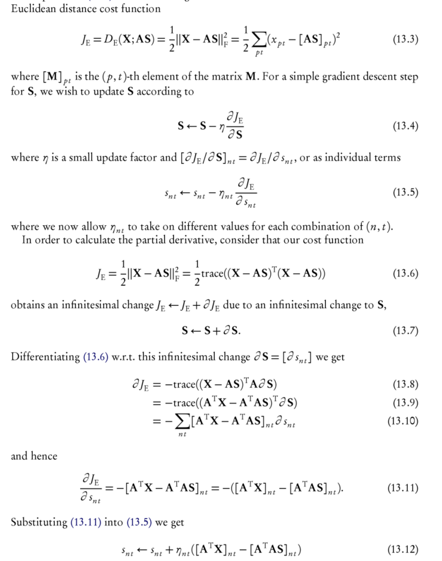

*Credits: materials from this notebook belong to YSDA [Practical DL](https://github.com/yandexdataschool/Practical_DL) course. Special thanks for making them available online.*

# Lab assignment №1, part 1

This lab assignment consists of several parts. You are supposed to make some transformations, train some models, estimate the quality of the models and explain your results.

Several comments:
* Don't hesitate to ask questions, it's a good practice.
* No private/public sharing, please. The copied assignments will be graded with 0 points.
* Blocks of this lab will be graded separately.

## 1. Matrix differentiation

Since it easy to google every task please please please try to undestand what's going on. The "just answer" thing will be not counted, make sure to present derivation of your solution. It is absolutely OK if you found an answer on web then just exercise in $\LaTeX$ copying it into here.

Useful links: 
[1](http://www.machinelearning.ru/wiki/images/2/2a/Matrix-Gauss.pdf)
[2](http://www.atmos.washington.edu/~dennis/MatrixCalculus.pdf)

## ex. 1

$$  
y = x^Tx,  \quad x \in \mathbb{R}^N 
$$

Градиент считаем столбцом: $dy=(\nabla_x y)^T dx$.
$$
y=\sum_{i=1}^N x_i^2,\qquad
\frac{\partial y}{\partial x_i}=2x_i,\qquad
\boxed{\nabla_x y=2x}.
$$
Проверка дифференциалом:
$$
dy=(dx)^Tx+x^Tdx=2x^Tdx.
$$

## ex. 2

$$ y = tr(AB) \quad A,B \in \mathbb{R}^{N \times N} $$

Для матрицы используем соглашение $dy=\operatorname{tr}((\nabla_A y)^T dA)$.
$$
y=\operatorname{tr}(AB)=\sum_i\sum_j A_{ij}B_{ji},\qquad
\frac{\partial y}{\partial A_{ij}}=B_{ji},\qquad
\boxed{\nabla_A y=B^T}.
$$
Также $dy=\operatorname{tr}(dA\,B)=\operatorname{tr}((B^T)^T dA)$.

## ex. 3

$$  
y = x^TAc , \quad A\in \mathbb{R}^{N \times N}, x\in \mathbb{R}^{N}, c\in \mathbb{R}^{N} 
$$

При фиксированных $A,c$:
$$
dy=(dx)^TAc=(Ac)^Tdx,\qquad \boxed{\nabla_x y=Ac}.
$$

При фиксированных $x,c$:
$$
y=\sum_{i,j}x_i A_{ij}c_j,\qquad
\frac{\partial y}{\partial A_{ij}}=x_i c_j,\qquad
\boxed{\nabla_A y=xc^T}.
$$
Через след: $dy=x^T(dA)c=\operatorname{tr}(cx^T dA)$,
поэтому $(\nabla_A y)^T=cx^T$. Размер градиента — $N\times N$.

Hint for the latter (one of the ways): use *ex. 2* result and the fact 
$$
tr(ABC) = tr (CAB)
$$

## ex. 4

Classic matrix factorization example. Given matrix $X$ you need to find $A$, $S$ to approximate $X$. This can be done by simple gradient descent iteratively alternating $A$ and $S$ updates.
$$
J = || X - AS ||_F^2  , \quad A\in \mathbb{R}^{N \times R} , \quad S\in \mathbb{R}^{R \times M}
$$
$$
\frac{dJ}{dS} = ? 
$$

You may use one of the following approaches:

**Решение через дифференциал.** Обозначим $E=AS-X$.
$$
J=\operatorname{tr}(E^TE),\qquad dJ=2\operatorname{tr}(E^T dE).
$$
При фиксированном $A$ имеем $dE=A\,dS$, следовательно
$$
dJ=2\operatorname{tr}(E^TA\,dS),\qquad
\boxed{\nabla_S J=2A^T(AS-X)}\in\mathbb R^{R\times M}.
$$
Для чередующейся оптимизации аналогично:
$$
\boxed{\nabla_A J=2(AS-X)S^T}\in\mathbb R^{N\times R}.
$$
Шаги: $S\leftarrow S-\eta\nabla_S J$, затем пересчитать остаток
и $A\leftarrow A-\eta\nabla_A J$ с уже обновлённым $S$.

#### First approach
Using ex.2 and the fact:
$$
|| X ||_F^2 = tr(XX^T) 
$$ 
it is easy to derive gradients (you can find it in one of the refs).

#### Second approach
You can use *slightly different techniques* if they suits you. Take a look at this derivation:

(excerpt from [Handbook of blind source separation, Jutten, page 517](https://books.google.ru/books?id=PTbj03bYH6kC&printsec=frontcover&dq=Handbook+of+Blind+Source+Separation&hl=en&sa=X&ved=0ahUKEwi-q_apiJDLAhULvXIKHVXJDWcQ6AEIHDAA#v=onepage&q=Handbook%20of%20Blind%20Source%20Separation&f=false), open for better picture).

#### Проверка правилом цепочки
Пусть $F=AS$, тогда
$$
\boxed{\nabla_F J=2(F-X)}.
$$
Производная матрицы по матрице требует выбора порядка координат.
При укладке **по столбцам**:
$$
\operatorname{vec}(F)=(I_M\otimes A)\operatorname{vec}(S),\qquad
\boxed{\frac{\partial\operatorname{vec}(F)}{\partial\operatorname{vec}(S)}
=I_M\otimes A}\in\mathbb R^{NM\times RM}.
$$
Правило цепочки для градиентов:
$$
\operatorname{vec}(\nabla_S J)
=(I_M\otimes A)^T\operatorname{vec}(2(F-X))
=\operatorname{vec}(2A^T(AS-X)).
$$
Получен тот же результат. Проверим все градиенты центральными разностями ниже.

```python
import numpy as np

rng = np.random.default_rng(42)

def numerical_gradient(function, argument, step=1e-6):
    gradient = np.zeros_like(argument)
    for index in np.ndindex(argument.shape):
        plus = argument.copy()
        minus = argument.copy()
        plus[index] += step
        minus[index] -= step
        gradient[index] = (function(plus) - function(minus)) / (2 * step)
    return gradient

x = rng.normal(size=3)
c = rng.normal(size=3)
A = rng.normal(size=(3, 3))
B = rng.normal(size=(3, 3))
S = rng.normal(size=(3, 4))
X = rng.normal(size=(3, 4))
def squared_norm(x):
    return x @ x


def trace_product(A):
    return np.trace(A @ B)


def bilinear_by_x(x):
    return x @ A @ c


def bilinear_by_A(A):
    return x @ A @ c


def loss_by_S(S):
    return np.sum((X - A @ S) ** 2)


def loss_by_A(A):
    return np.sum((X - A @ S) ** 2)


def check_gradient(name, function, argument, expected):
    actual = numerical_gradient(function, argument)
    np.testing.assert_allclose(actual, expected, rtol=1e-5, atol=1e-6)
    error = np.max(np.abs(actual - expected))
    print(name, 'max absolute error:', error)


check_gradient('x.T @ x', squared_norm, x, 2 * x)
check_gradient('trace(A @ B)', trace_product, A, B.T)
check_gradient('x.T @ A @ c: x', bilinear_by_x, x, A @ c)
check_gradient('x.T @ A @ c: A', bilinear_by_A, A, np.outer(x, c))
check_gradient('J: S', loss_by_S, S, 2 * A.T @ (A @ S - X))
check_gradient('J: A', loss_by_A, A, 2 * (A @ S - X) @ S.T)

# order='F' означает укладку элементов по столбцам, как в выводе выше.
jacobian = np.kron(np.eye(S.shape[1]), A)
np.testing.assert_allclose(
    jacobian @ S.ravel(order='F'), (A @ S).ravel(order='F')
)
print('All gradient checks and the column-wise Jacobian check passed.')
```

## 2. kNN questions
Here come the questions from the assignment0_01. Please, refer to the assignment0_01 to get the context of the questions.

### Question 1

Notice the structured patterns in the distance matrix, where some rows or columns are visible brighter. (Note that with the default color scheme black indicates low distances while white indicates high distances.)

- What in the data is the cause behind the distinctly bright rows?
- What causes the columns?

*Your Answer:*


**Ответ.** Если строки соответствуют test, а столбцы — train, яркая строка означает
тестовое изображение, далёкое почти от всех обучающих: например, необычная форма,
фон, яркость или контраст. Яркий столбец — такое же нетипичное изображение в train.
Причина в значениях признаков, а не в номере класса: метки при расчёте расстояний
не используются. По одной матрице нельзя установить конкретную визуальную причину;
для этого нужно посмотреть сами изображения. Если матрица транспонирована, роли
строк и столбцов меняются.

### Question 2

We can also use other distance metrics such as L1 distance.
For pixel values $p_{ij}^{(k)}$ at location $(i,j)$ of some image $I_k$, 

the mean $\mu$ across all pixels over all images is $$\mu=\frac{1}{nhw}\sum_{k=1}^n\sum_{i=1}^{h}\sum_{j=1}^{w}p_{ij}^{(k)}$$
And the pixel-wise mean $\mu_{ij}$ across all images is 
$$\mu_{ij}=\frac{1}{n}\sum_{k=1}^np_{ij}^{(k)}.$$
The general standard deviation $\sigma$ and pixel-wise standard deviation $\sigma_{ij}$ is defined similarly.

Which of the following preprocessing steps will not change the performance of a Nearest Neighbor classifier that uses L1 distance? Select all that apply.
1. Subtracting the mean $\mu$ ($\tilde{p}_{ij}^{(k)}=p_{ij}^{(k)}-\mu$.)
2. Subtracting the per pixel mean $\mu_{ij}$  ($\tilde{p}_{ij}^{(k)}=p_{ij}^{(k)}-\mu_{ij}$.)
3. Subtracting the mean $\mu$ and dividing by the standard deviation $\sigma$.
4. Subtracting the pixel-wise mean $\mu_{ij}$ and dividing by the pixel-wise standard deviation $\sigma_{ij}$.
5. Rotating the coordinate axes of the data.

*Your Answer:*


*Your Explanation:*


**Ответ: 1, 2, 3**, если одинаковое преобразование применяется к train и test,
а $\sigma>0$; статистики оцениваются только по train.

Для L1 $d(x,z)=\sum_j|x_j-z_j|$ общий сдвиг сокращается:
$$
d(x-a,z-a)=\sum_j|(x_j-a_j)-(z_j-a_j)|=d(x,z).
$$
Это верно и для скалярного среднего (1), и для вектора попиксельных средних (2).
Общее положительное масштабирование (3) умножает все расстояния на $1/\sigma$,
поэтому порядок соседей и совпадения расстояний сохраняются.

В (4) получается взвешенная L1-метрика $\sum_j|x_j-z_j|/\sigma_j$:
разные веса могут поменять ближайшего соседа. При $\sigma_j=0$ деление вообще
не определено без отдельного правила обработки постоянного признака.

Общий поворот (5) сохраняет L2, но не L1. Например, от начала координат до
$a=(1,1)$ и $b=(1.5,0)$ L1-расстояния равны 2 и 1.5: ближе $b$.
После поворота на $45^\circ$ получаем $a'=(0,\sqrt2)$,
$b'=(1.5/\sqrt2,1.5/\sqrt2)$: расстояния $\sqrt2$ и $1.5\sqrt2$,
теперь ближе $a$. Отдельные повороты, эквивалентные перестановкам и сменам знаков
координат, L1 сохраняют, но утверждение о произвольном повороте неверно.

## Question 3

Which of the following statements about $k$-Nearest Neighbor ($k$-NN) are true in a classification setting, and for all $k$? Select all that apply.
1. The decision boundary (hyperplane between classes in feature space) of the k-NN classifier is linear.
2. The training error of a 1-NN will always be lower than that of 5-NN.
3. The test error of a 1-NN will always be lower than that of a 5-NN.
4. The time needed to classify a test example with the k-NN classifier grows with the size of the training set.
5. None of the above.

*Your Answer:*


*Your Explanation:*


**Ответ: 4** в обычной реализации kNN с прямым поиском соседей.

1. Неверно: граница обычно кусочно-линейная и сложная, а не одна гиперплоскость.
2. Неверно из-за слова «всегда ниже». Без дубликатов с конфликтующими метками
1-NN при оценке на собственной обучающей выборке имеет нулевую ошибку,
но у 5-NN она тоже может быть нулевой. Например, если каждый объект окружён
как минимум пятью объектами своего класса. Значит, строгое неравенство не гарантировано.
При одинаковых признаках и разных метках даже нулевая train-ошибка 1-NN не гарантируется.
3. Неверно: 1-NN чувствителен к шуму, а усреднение голосов у 5-NN может улучшить
обобщение; обратная ситуация тоже возможна.
4. Верно для прямого поиска: надо вычислить расстояния до $n$ объектов,
стоимость порядка $O(nd)$ плюс выбор соседей. Индексы вроде KD-tree могут
ускорять поиск на подходящих данных, но это уже уточнение реализации,
а не независимость вычислений от объёма train.
5. Неверно, поскольку в рассматриваемой реализации верен пункт 4.
